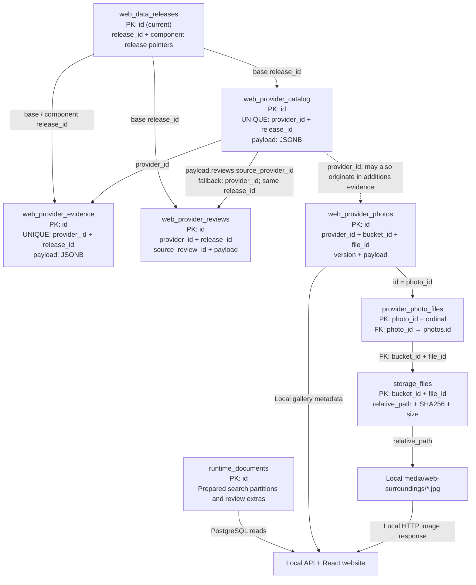

# EqualPath — local PostgreSQL edition

Run the complete existing React website with a local API, PostgreSQL database and local surroundings images. No Appwrite account or API key is required after cloning. This is an independent local mode: it does not deploy or write to the production website.

## Quick start

Requirements: Node.js 22+, Python 3.10+, PostgreSQL 16+ (`initdb`, `pg_ctl`, `psql`, `createdb` on PATH). Native startup supports macOS and Linux; use WSL on Windows. Run from the repository root:

```sh
npm ci
npm run local:setup
npm run local:verify
npm run local:start
```

Open **http://127.0.0.1:4180**. Use the normal landing, search, centre details, reviews, comparison, favourites and photo viewer. Port 4180 is strict: startup fails if another process owns it.

Press Ctrl+C to stop the website. Stop the isolated database separately:

```sh
npm run local:stop
```

The database persists under `database/postgres/.local/pgdata` (Git-ignored). Startup creates a private Unix socket directory, uses database/user `equalpath`, and disables TCP entirely. It does not use or modify an existing PostgreSQL service. Local socket authentication trusts the current OS user; the socket directory is owner-only. Never expose this development setup as a public server.

### What “local” means

The frontend, API, provider data, review profiles, database and 276 image objects run locally. Search requests and images do not call Appwrite. Browser favourites and preferences remain in localStorage, scoped to this local origin.

**This is not a fully offline map stack.** Map tiles, address lookup and road routing retain the existing external map/geocoding/OSRM providers and require internet access. Without them, those functions can be unavailable; road times are never fabricated. External contact/source links remain user-initiated. The cloud Telegram enquiry experiment is disabled in local mode; there is no automatic external messaging. No parent accounts, private conversations or owner records are copied.

## Database diagram

Solid foreign keys exist only for the local photo-file association. Provider/release edges below are logical joins, preserving the original versioned data model without inventing missing catalogue rows.



### Tables and link rules

The five `web_*` tables preserve source business fields. Appwrite `$id` becomes SQL `id`; stringified `payload` becomes queryable `JSONB`. Appwrite permissions, owner IDs in permission strings and administrative metadata are not exported.

- **Catalogue → evidence:** match `provider_id`. Select the evidence version using `web_data_releases/current.payload` (`hours_release`, `fees_release`, `services_release`, `admissions_release`, `additions_release`, `profile_evidence_release`). These releases differ from the base catalogue release. Some newly added providers exist only in additions evidence, so a blanket catalogue foreign key would reject valid source data.
- **Catalogue → reviews:** match `COALESCE(payload #>> '{reviews,source_provider_id}', provider_id)` to the review's `provider_id`, within the same base `release_id`. Several registration entries may share one review source. `source_review_id` identifies the original review; it is not an institution key.
- **Photos → files:** `web_provider_photos.payload.images` retains order, direction and capture metadata. `provider_photo_files` links each image to its local `storage_files` record with real foreign keys. Original source URLs remain provenance only; the local frontend uses `/media/...` URLs.
- **Release manifest:** `id = 'current'` is a mutable pointer, not a release history table. It cannot be a foreign-key parent for every historical/component release.

## Runtime data and source replica

The website already uses prepared snapshots and later review/fee enrichments. Copying the raw Appwrite tables alone would regress current search behavior. Therefore `runtime_documents` stores the repository's exact validated `server/data/search-index` partitions, manifest and review extras in PostgreSQL. The local API loads those records through `store.mjs`; it never silently falls back to files or Appwrite when PostgreSQL fails. Small lookup caches are process-local; restart the website after importing updated runtime documents.

The source tables are available for inspection and SQL joins. **Editing a raw source row does not automatically rebuild the runtime search documents.** `local:setup` imports the bundled source export and the current checked-in search artifacts. It is repeatable, transactional and performs upserts, not deletion of extra user-added rows. `local:verify` requires exact snapshot parity and will report extra/changed rows. Use a fresh isolated database when exact replication is needed.

## Inspect and query

Open a SQL shell (the wrapper supplies the private socket settings):

```sh
python3 database/postgres/scripts/local.py psql
```

```sql
-- Inspect all tables and views.
\dt equalpath.*
\dv equalpath.*

-- Active short-care profiles, including their complete JSON details.
SELECT e.provider_id, e.payload
FROM equalpath.web_provider_evidence e
JOIN equalpath.web_data_releases r ON r.id = 'current'
 AND e.release_id = r.payload->>'profile_evidence_release';

-- Find a provider, then use its provider_id in the next queries.
SELECT provider_id, provider_name, release_id
FROM equalpath.active_catalog
WHERE provider_name ILIKE '%TASKA%' LIMIT 10;

-- Evidence links for active catalogue entries.
SELECT c.provider_name, e.release_id, e.payload
FROM equalpath.provider_evidence_links l
JOIN equalpath.web_provider_catalog c ON c.id=l.catalog_row_id
JOIN equalpath.web_provider_evidence e ON e.id=l.evidence_row_id
LIMIT 5;

-- Shared review-source mapping is handled by this view.
SELECT c.provider_name, v.source_review_id, v.payload
FROM equalpath.provider_review_links l
JOIN equalpath.web_provider_catalog c ON c.id=l.catalog_row_id
JOIN equalpath.web_provider_reviews v ON v.id=l.review_row_id
LIMIT 5;

SELECT * FROM equalpath.local_photo_gallery LIMIT 5;
```

## Data provenance and refresh

`data/manifest.json` records export time, table counts and SHA-256 hashes. The bundled snapshot contains 3,539 catalogue rows, 11,501 reviews, 8,121 evidence rows, one release pointer and 98 photo records. The 98 photo records have 282 image associations referencing 276 unique local JPEGs (some files are shared). Only active base/component releases are included; obsolete releases are not a historical backup. `data/media-manifest.json` records every bucket file, checksum, relative path and photo association. All images are checked against their published content hashes. The image source is Google Street View; retain source attribution, capture dates and location-review caveats. Source material retains its original rights; this repository does not grant new redistribution rights.

Only explicit maintenance commands access Appwrite, using anonymous reads of allowlisted public tables and bucket:

```sh
python3 database/postgres/scripts/export_appwrite.py
python3 database/postgres/scripts/export_media.py
npm run local:setup
npm run local:verify
```

Run both exports successfully before importing. Review and commit their new manifests together. Export files are read-only snapshots, not a live transactional backup; the exporter checks unique IDs, uncapped row counts and the current release pointer (Appwrite caps reported totals at 5,000), but cannot detect every concurrent source edit. Source values are not assertions of current availability, vacancies, fees or independent verification.

The full production application and its release commands remain available in this repository. For this local branch use **`local:setup` / `local:start`**, not the Appwrite deployment commands. No production release is needed for this edition.
